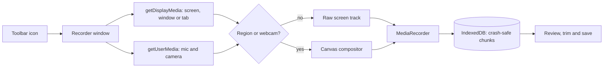

<div align="center">

# Clipora

**A fast, private screen recorder for Chrome. No account. No uploads. No permissions.**

Record your screen, a window, a tab or just part of it. Add your webcam and voice, trim the result, and save it as MP4 or WebM.


[Features](#features) · [Install](#installation) · [User guide](#user-guide) · [Shortcuts](#keyboard-shortcuts) · [Troubleshooting](#troubleshooting) · [FAQ](#faq) · [Contributing](#contributing)

</div>

---

## Why this exists

Most screen recorders ask you to sign up, upload your video to their servers, or install a heavy desktop app. This one is a small Chrome extension that does the whole job on your own computer:

- **Private by design.** Your recordings never leave your machine. The extension makes no network requests and contains no analytics.
- **Zero permissions.** It does not read your tabs, browsing history or websites. Chrome only asks for screen, camera and microphone access at the moment you use them.
- **Nothing to build.** Plain HTML, CSS and JavaScript with no dependencies and no build step.
- **Safe for long recordings.** Video is written to disk as you record, so a crash does not cost you the take.

## Features

| | |
| --- | --- |
| **Flexible capture** | Record a full screen, a single window, a browser tab, or **drag out part of the screen**. Move and resize the selected area with handles. |
| **Webcam bubble** | Add a round camera overlay. Drag it anywhere, resize it with a slider, even while recording. |
| **Audio you can trust** | Record system or tab audio and your microphone together, with **live level meters** that confirm sound is coming in before you press record. |
| **Clean starts** | Optional **3-2-1 countdown** so the first seconds aren't spent reaching for the mouse. |
| **Quality control** | Choose **Small, Standard or High** quality (4 / 8 / 16 Mbps) at **30 or 60 fps**. |
| **MP4 or WebM** | Save as MP4 for compatibility, or WebM if you prefer. WebM files are repaired so they show a duration and seek properly. |
| **Pause and resume** | Cut out the boring parts while you record. |
| **Trim** | Cut the start and end of a recording before you save it, with a preview. |
| **Crash recovery** | If Chrome or your computer crashes mid-recording, the next launch offers to recover it. |
| **Keyboard shortcuts** | Control everything without touching the mouse. |
| **Remembers you** | Your settings are saved between sessions. |
| **Save your way** | Rename the file and pick the folder in Chrome's save dialog. |

## Installation

The extension is installed straight from the source folder, so there is nothing to build.

1. **Download** this repository (green **Code** button, then **Download ZIP**) and unzip it, or clone it:
   ```bash
   git clone https://github.com/<your-username>/clipora.git
   ```
2. In Chrome, open **`chrome://extensions`**.
3. Turn on **Developer mode** (switch in the top-right corner).
4. Click **Load unpacked** and select the **`clipora`** folder (the one containing `manifest.json`).
5. *(Optional)* Click the puzzle-piece icon in Chrome's toolbar and **pin** Clipora for one-click access.

**Requirements:** Chrome 116 or newer (or another Chromium-based browser such as Edge, Brave or Opera). **MP4 recording needs Chrome 126 or newer.** On older versions the app saves WebM automatically and tells you so.

**Updating:** replace the folder with the new version and click the reload icon on the extension's card in `chrome://extensions`.

## User guide

### 1. Open the recorder

Click the Clipora icon in the toolbar. A recorder window opens. Clicking the icon again brings that window back to the front instead of opening a second one.

### 2. Choose your settings

On the start screen, set up what you want before you pick a source.

| Setting | What it does |
| --- | --- |
| **System or tab audio** | Records the sound your computer or the chosen tab plays. |
| **Microphone** | Records your voice. Chrome asks for permission the first time. |
| **Webcam bubble** | Adds a round camera overlay to the recording. Chrome asks for permission the first time. |
| **3-2-1 countdown** | Counts down before recording starts. |
| **Quality** | *Small file* (4 Mbps), *Standard* (8 Mbps) or *High* (16 Mbps). Use **High** for fine text and detail, **Small** for long recordings. |
| **Frame rate** | **30 fps** suits tutorials and meetings. **60 fps** is smoother for games and fast motion but makes bigger files. |
| **Format** | **MP4** works almost everywhere. **WebM** is a good open alternative. |

All of these are remembered for next time.

### 3. Pick what to record

- **Screen, window or tab** records everything in the source you pick.
- **Part of the screen** lets you choose a source first, then select just an area of it.

After you click, Chrome shows its own picker. Choose a **Chrome Tab**, **Window** or **Entire Screen**, and tick **Share audio** if you want system or tab audio.

> **Tip:** the recorder window itself appears in a full-screen recording. Either use the countdown to switch to the app you want to show, or record a single window or tab.

### 4. Frame your shot

You now see a live preview.

**Selecting part of the screen**
1. Drag on the preview to draw a rectangle.
2. Drag inside the rectangle to **move** it.
3. Drag the **round handles** on the corners and edges to **resize** it. The size in pixels is shown above the box.
4. Draw a new rectangle at any time by dragging outside the current one.

**Using the webcam bubble**
- Drag the bubble to move it.
- Use the **Camera size** slider to make it bigger or smaller.
- The bubble stays inside the recorded area, and you can still move it while recording.

**Checking your audio**
The **meters** under the preview show live levels for system audio and your microphone. If a bar moves when you make sound, that source is working. If a meter shows a warning instead, see [Troubleshooting](#troubleshooting).

### 5. Record

Press the **Record** button (or `Space`). If the countdown is on, you get a 3-2-1 first, and `Esc` cancels it.

While recording you can:

- **Pause** (`Space`) and **Resume** (`Space`) to skip parts you don't want. The timer stops while paused.
- **Stop** with the Stop button to finish.
- Click Chrome's **Stop sharing** bar at any time. That also ends the recording and takes you to the review screen.

The window title shows the running time (`● 02:15 Recording`), so you can see the status even when the window is behind other apps.

### 6. Review, trim and save

When you stop, you see the finished recording with the **duration, file size and format**.

- **Watch it** with the built-in player.
- **Rename it:** type a name in the **File name** box. Characters that aren't allowed in file names are removed for you.
- **Trim it:** open **Trim start and end**, set the **Start** and **End** sliders, use **Preview selection** to check, then **Apply trim**. Use **Restore original** to go back.
- **Save it:** press **Save as MP4** (or WebM), or `S`. Chrome's save dialog lets you choose the folder. If the dialog isn't available, the file goes to your normal Downloads folder.

Press **New recording** (or `N`) to start again.

> **Trim takes real time.** Trimming re-encodes the clip as it plays, so a one-minute clip takes about a minute and quality drops slightly. Keep the window open until it finishes. You can cancel with `Esc`.

### 7. Recover a lost recording

While you record, the video is saved to the extension's own storage. If Chrome or your computer crashes, or you close the window before saving, open the recorder again. A banner at the top of the start screen offers **Recover** or **Discard**.

Starting a new recording discards any unsaved recovery copy, and saving a recording removes its recovery copy automatically.

## Keyboard shortcuts

| Key | Action |
| --- | --- |
| `Space` | Record, pause or resume (on the recording screen) |
| `Esc` | Cancel the countdown, or go back to choose a different source |
| `S` | Save the recording (on the review screen) |
| `N` | Start a new recording |

## How it works



- The recording uses the browser's standard **`getDisplayMedia`** and **`MediaRecorder`** APIs.
- When you select a region or add the webcam, frames are drawn onto a canvas and recorded from there. A small web worker (`timer-worker.js`) keeps the canvas ticking at full speed even when the recorder window is in the background.
- Every second of video is written to **IndexedDB**. This is what makes crash recovery possible and keeps memory use low on long recordings.
- `webm-fix.js` adds the missing duration to WebM files, which `MediaRecorder` leaves out, so they seek properly in players.

### Project structure

```
clipora/
├── manifest.json      Manifest V3, no permissions
├── background.js      Opens or focuses the recorder window
├── recorder.html      The app interface
├── recorder.css       Styles (light and dark mode)
├── recorder.js        Capture, countdown, region, webcam, meters, trim, save, recovery
├── timer-worker.js    Background-safe frame timer
├── webm-fix.js        Adds duration metadata to WebM files
├── icons/             Extension icons (16, 32, 48, 128 px)
├── LICENSE            MIT
└── README.md
```

## Privacy

- **No network.** The extension makes no requests, loads no remote code and has no analytics.
- **No permissions.** The manifest requests none, so the extension cannot read your websites or browsing data.
- **What is stored, and where:**
  - Your **settings** (toggles, quality and camera position) in the browser's `localStorage`.
  - A **temporary recovery copy** of your latest unsaved recording in IndexedDB. It is removed when you save, discard it, or start a new recording.
- **Recordings** exist only in memory and on that temporary copy until you save them, and then only in the file you choose.

## Troubleshooting

<details>
<summary><strong>There is no sound in my recording</strong></summary>

Look at the meters on the preview screen before recording.

- **System audio warning:** you did not tick **Share audio** in Chrome's picker. Go back, pick the source again and tick it. Chrome offers audio sharing for **tabs** on every system, and for **entire screens** on Windows and ChromeOS only. Individual **windows** cannot share audio. On macOS and Linux, record a tab to capture its sound.
- **Microphone warning:** Chrome blocked the microphone or none was found. Click the lock icon in the address bar of the recorder window, allow the microphone, and try again. Also check that the right input device is selected in your system settings.
- Both meters moving but the file is silent: report it as an issue and include your Chrome and OS versions.
</details>

<details>
<summary><strong>I only get WebM, not MP4</strong></summary>

MP4 recording needs **Chrome 126 or newer**. Update Chrome from **Settings → About Chrome**. You can also choose WebM yourself in the **Format** setting.
</details>

<details>
<summary><strong>The video is black or blank</strong></summary>

Some apps and sites block screen capture of protected content (for example streaming services using DRM). This is enforced by the browser and operating system, and the recorder cannot get around it.
</details>

<details>
<summary><strong>The recorder window appears in my recording</strong></summary>

When you record the entire screen, everything on it is captured, including this window. Turn on the **countdown** and switch to the app you want to show, or record just one **window** or **tab**.
</details>

<details>
<summary><strong>The camera bubble does not show</strong></summary>

- Make sure **Webcam bubble** was on **before** you picked the source.
- Chrome must be allowed to use the camera. Click the lock icon in the recorder window's address bar to check.
- Close other apps that may be using the camera (video-call apps often lock it).
</details>

<details>
<summary><strong>Recording is choppy or my computer slows down</strong></summary>

Selecting a region or adding the webcam makes the recorder redraw every frame, which uses more CPU. Try **30 fps**, **Standard** or **Small** quality, or record a smaller area. Closing heavy apps helps too.
</details>

<details>
<summary><strong>Trimming is slow or failed</strong></summary>

Trimming runs in real time, so a long clip takes as long as the part you keep. Keep the window open and avoid minimizing it. If it fails, use **Restore original** and try a shorter selection, or save the full recording and trim it in a video editor.
</details>

<details>
<summary><strong>The recovery banner offers a recording I don't need</strong></summary>

Click **Discard**, or just start a new recording.
</details>

## FAQ

**Is it really free and private?**
Yes. There is no server behind this extension. Everything is processed by your own browser.

**Does it work in browsers other than Chrome?**
It should work in other Chromium-based browsers (Edge, Brave, Opera) that support Manifest V3. It is tested on Chrome.

**Is there a recording time limit?**
No built-in limit. Recordings are saved to disk as you go, so the practical limit is your free disk space.

**Can I record a specific application?**
Yes. Choose **Window** in Chrome's picker. To record only part of the screen, use **Part of the screen**.

**Why does trimming lower the quality a little?**
Trimming re-encodes the video. To avoid any loss, save the full recording and cut it in a video editor.

**Can it draw on the screen or highlight my cursor?**
Not at the moment. Doing that over other applications would need extra browser permissions, which would break the "zero permissions" promise.

## Roadmap

Ideas for future versions. Contributions welcome.

- [ ] GIF export
- [ ] Faster, lossless trim for MP4
- [ ] Optional mirror mode for the webcam
- [ ] Configurable countdown length
- [ ] Localization

## Contributing

Contributions, bug reports and ideas are welcome.

1. **Fork** the repository and create a branch for your change.
2. Load the extension as described in [Installation](#installation). There is no build step, so edit the files and click the reload icon on `chrome://extensions`.
3. Test the main flows: full-screen, region, webcam, pause and resume, trim, save and recovery.
4. Open a **pull request** that explains what changed and why.

When reporting a bug, please include your Chrome version, operating system, the steps to reproduce, and what you expected to happen.

## License

Released under the [MIT License](LICENSE). Free to use, modify and share.

<div align="center">

If this tool saved you time, consider giving the repository a star.

</div>
